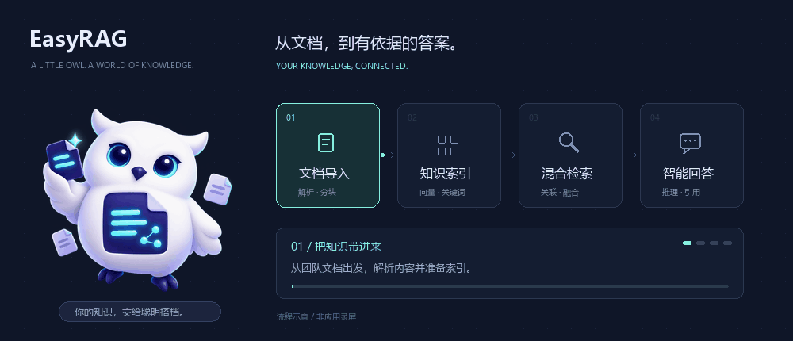

<div align="center">
  <a href="https://reques.github.io/EasyRAG/">
    
  </a>
  <h1>EasyRAG</h1>
  <p><strong>让知识，有问必答。</strong></p>
  <p>你的知识库，多了一位聪明搭档。<br>混合检索 · 知识图谱 · 可追溯问答 · 多智能体深度研究</p>
  <p>
    <a href="https://reques.github.io/EasyRAG/">项目主页 ↗</a> ·
    <a href="#快速开始">快速开始</a> ·
    <a href="docs/ARCHITECTURE.md">架构文档</a> ·
    <a href="https://github.com/reques/EasyRAG/issues">反馈与建议</a>
  </p>
</div>

[](https://www.python.org/)
[](https://fastapi.tiangolo.com/)
[](https://vuejs.org/)
[](https://milvus.io/)
[](LICENSE)

<a href="https://github.com/reques/EasyRAG/">
  
</a>

<p align="center"><sub>原创 3D 吉祥物与知识流转动图；动图为流程示意，非应用录屏。<a href="site/assets/overview-poster.png">查看静态版本</a>。</sub></p>

EasyRAG 是一个面向企业知识库场景的开源全栈平台，将文档解析、多策略 RAG、Agent 工具调用与多智能体协作放进同一个工作空间。

| 能力 | 可以做什么 |
|------|------------|
| 混合检索 | 向量与 BM25 多路召回、融合排序、可选重排，为回答找到相关依据 |
| 知识图谱 | 提取实体与关系，关联分散文档，辅助发现跨文档线索 |
| 智能体协作 | ReAct 按需调用工具，Deep Research 拆解与委派子任务 |
| Skills 与 MCP | 配置技能、接入外部工具，扩展智能体能力 |
| 流式与可追溯 | SSE 流式回答、引用来源、任务进度与产物预览 |
| 自主部署 | Docker Compose 编排，支持 OpenAI 兼容 API 与本地嵌入方案 |

项目主页源码位于 [`site/`](site/)，访问 [reques.github.io/EasyRAG](https://reques.github.io/EasyRAG/)。发布步骤与品牌素材说明见 [主页维护文档](site/README.md)。

---

## 技术栈

| 层 | 选型 |
|----|------|
| 前端 | Vue 3.5 · Vite 6 · Pinia · Axios · lucide 图标 |
| 后端 | FastAPI（async）· SQLAlchemy 2.0 async · LangGraph 工作流 |
| Agent | LangGraph（意图分流 / ReAct 循环 / 校验重试）· DeepAgents 统一多智能体（主 Agent + SubAgent + DAG 委派 + 结构化黑板） |
| 存储 | PostgreSQL（pgvector 镜像，业务数据 + 图谱 + Skill 配置）· Redis · RustFS（S3 兼容对象存储） |
| 向量 | Milvus 2.5（etcd + RustFS 依赖）· BGE-M3 embedding（Ollama 本地 / API） |
| LLM | DeepSeek / MiniMax / Qwen(DashScope) / GLM / 任意 OpenAI 兼容 API |
| 文档解析 | 本地解析器 + 旁路部署 MinerU Pipeline API（Docker） |
| 评估 | 本地确定性指标（HitRate / MRR / avg_score）+ 可选 Ragas（独立 venv） |
| 部署 | Docker Compose 一键编排 |

---

## 快速开始

### 前置依赖

- Docker Desktop（或安装了 Docker Compose 插件的 Docker Engine）

### 1. 配置

```bash
git clone https://github.com/reques/EasyRAG.git
cd EasyRAG
cp .env.template .env
```

在 `.env` 中至少配置一个可用的对话模型 API Key，例如
`DEEPSEEK_API_KEY`、`DASHSCOPE_API_KEY`、`MINIMAX_API_KEY` 或
`ZHIPUAI_API_KEY`。

### 2. 一键启动

```bash
docker compose up -d          # 仅在首次构建、或改过依赖/前端源码时加 --build
```

> `--build` 会把**每个**带 `build:` 的服务重建一遍（backend、frontend，以及
> MinerU）。镜像已存在时请直接 `up -d`，否则每次启动都要白等数分钟。
> 只重建后端：`docker compose up -d --build backend`。

该命令会统一启动：

- Vue 前端（Nginx）
- FastAPI 后端和内嵌文件索引 Worker
- PostgreSQL、Redis、应用 RustFS（S3 兼容对象存储，原 MinIO）
- Milvus、etcd 和 Milvus 专用 RustFS
- Neo4j
- Ollama，并在首次启动时自动拉取 `bge-m3` 嵌入模型

服务健康后打开 [http://localhost:5173](http://localhost:5173)。后端接口和
Swagger 分别位于 `http://localhost:8000/api/v1` 和
[http://localhost:8000/docs](http://localhost:8000/docs)。

首次启动需要下载 Docker 镜像、Python 依赖和嵌入模型，耗时较长。查看状态和日志：

```bash
docker compose ps
docker compose logs -f backend frontend
```

停止服务：

```bash
docker compose down
```

业务数据保存在项目的 `volumes/` 目录和 `easyrag-ollama-data` Docker
volume 中，普通的 `docker compose down` 不会删除。

需要 NVIDIA GPU 版 MinerU 时，在 `.env` 中设置
`DOCKER_MINERU_ENABLED=true`，然后执行：

```bash
docker compose --profile mineru up -d      # 镜像已构建时；首次再加 --build
```

> MinerU 镜像约 14GB（内含 pipeline 模型），构建一次后**不要再用 `--build`**
> 整体重建。
>
> **本地嵌入（可选）**：后端镜像默认**不装** `torch` / `transformers` /
> `sentence-transformers`——docker 部署走 Ollama 嵌入，代码里 `sentence_transformers`
> 是惰性导入（`app/rag/embeddings.py`、`app/rag/reranker.py`），装了纯属浪费 1GB+。
> 需要 `EMBEDDING_TYPE=local` 或本地 cross-encoder 重排时：
> `docker compose build --build-arg INSTALL_ML_DEPS=true backend`；
> 本地源码环境则 `pip install -r requirements-ml.txt`。
>
> **构建加速**：在 `.env` 中按 `.env.template` 填 `PIP_INDEX_URL` /
> `PYTORCH_INDEX_URL` / `NPM_REGISTRY` 走国内镜像，可显著缩短首次构建。

端口可通过 `.env` 中的 `FRONTEND_PORT`、`BACKEND_PORT`、
`POSTGRES_EXPOSE_PORT` 等变量修改。完整选项见 `.env.template`。

> 本地源码开发仍可分别运行 Uvicorn 和 Vite。MinerU 详细说明见
> [deploy/mineru/README.md](deploy/mineru/README.md)；Ragas 评估环境见
> [docs/ragas-evaluator.md](docs/ragas-evaluator.md)。

---

## 文档导航

根目录保留项目说明、依赖声明、测试配置和 Docker 启动文件。MCP 配置集中在
`config/`，维护脚本在 `scripts/`，可选评估依赖在 `eval/`，旧版入口保存在
`examples/legacy/`。本地后端开发使用：

```bash
python -m uvicorn backend.server.main:app --host 0.0.0.0 --port 8000 --reload
```

Windows 重启脚本为 `scripts/restart-backend.bat`，使用当前 Python 环境；也可通过
`PYTHON_EXECUTABLE` 指定解释器。MCP 默认读取 `config/mcp_servers.json`，
可通过 `MCP_SERVERS_FILE` 指定其他配置文件。

根目录 `tests/` 仅在本地保留，不随 Git 仓库分发；前端测试、`pytest.ini`、业务
评估功能、MinerU 部署检查与维护诊断脚本仍保留在仓库中。

| 文档 | 内容 |
|------|------|
| [docs/ARCHITECTURE.md](docs/ARCHITECTURE.md) | 项目结构与逻辑（模块详解、核心设计、API 概览） |
| [docs/ARCHITECTURE_DETAILED.md](docs/ARCHITECTURE_DETAILED.md) | 整体架构深度详解（请求生命周期、LangGraph 工作流、增强检索流水线、图谱子系统） |
| [docs/PROGRESS.md](docs/PROGRESS.md) | 逐次迭代的演进记录 |
| [docs/plans/](docs/plans/) · [docs/specs/](docs/specs/) | 设计稿与规格说明 |
| [deploy/mineru/README.md](deploy/mineru/README.md) | MinerU 解析服务部署与运维 |
| [docs/ragas-evaluator.md](docs/ragas-evaluator.md) | 可选 Ragas 评估部署 |

---

## License

MIT — 见 [LICENSE](LICENSE)
