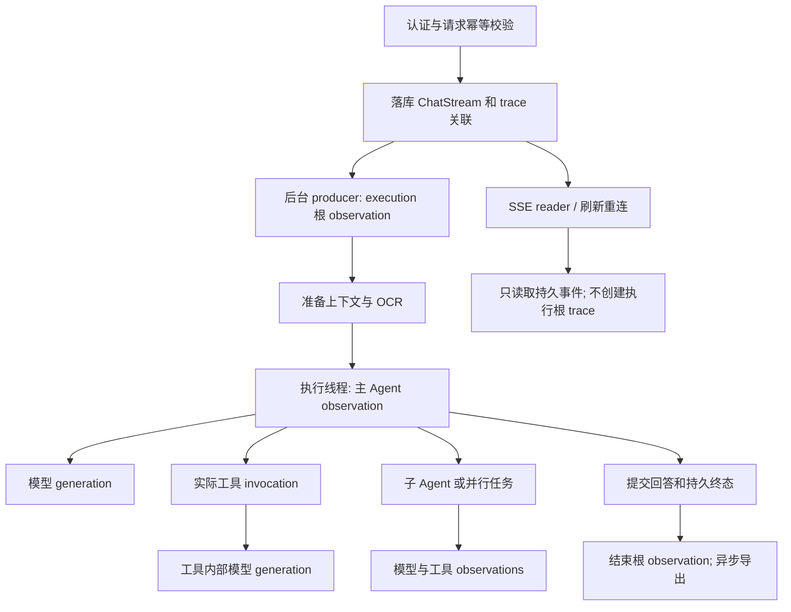

# EasyRAG Langfuse 观测接入规划

规划日期：2026-10-16。实施更新：2026-10-18，P0–P2 已完成代码接入，可选本地自托管栈已部署，真实模型/工具/子智能体、重连及取消的候选验收通过；待同步 main/home 后更新正式业务容器。验证记录见 [实施验收](../langfuse-implementation-verification.md)。

**目标：** 将一次顶层 Agent 执行中的模型调用、工具调用、子智能体、耗时和错误归入同一条 Langfuse trace，能够按用户、会话、执行请求和智能体排查问题，同时保留现有断线恢复、持久事件和快速取消能力。

**架构：** PostgreSQL 与 checkpoint 继续决定业务状态；Langfuse 是可关闭、异步导出的观测后端。以持久执行 `ChatStream.id` 关联 trace，在后台 producer 中建立根 observation，通过请求上下文传播到执行线程、子智能体和工具；LangChain 模型与自研 LLMClient 各有一个观测入口。

**技术基线：** 当前项目 Python 3.11、FastAPI、SQLAlchemy/PostgreSQL、LangChain/LangGraph 1.x、OpenAI SDK、自定义可取消 HTTPX transport、Vue 3、Docker Compose。建议接入 Langfuse Python SDK 5.x；依赖安装、服务部署属于后续实施工作。

## 1. 当前项目的真实情况

| 现有能力与代码位置 | 当前行为 | 接入时需要处理的地方 |
| --- | --- | --- |
| `backend/services/chat_stream_service.py`、`models_chat_stream.py` | ChatStream 先落库；后台 producer 独立于 SSE 连接；事件按 sequence 重放；取消有独立接口 | 根 trace 应属于 producer 的执行生命周期，而不是每次 HTTP/SSE 连接 |
| `app/agents/context.py`、`request_context.py` | ChatContext 携带 user、thread、模型和授权上下文；ContextVar 向工具传播 | 增加明确的 execution/observability 字段，不复用含义不同的 `run_id` |
| `app/agents/events.py` | 本地 trace ID 当前为 16 位十六进制；提供规范化事件、上下文快照 | 与 Langfuse/OTel 的 32 位 trace ID 分开；不能把进度事件当作完整模型调用审计 |
| `app/services/agent_service.py` | dynamic/deep 入口各自创建 `use_request_trace`；外层 request_context 也创建一次 | 收拢同一次业务执行的事件 trace，避免内部替换 trace ID；保留显式新请求的独立作用域 |
| `app/observability/tracing.py` | 已有可选 OTel 包装，工具、委派和 ASGI 使用它；未配置 exporter | `trace_span` 使用 `start_span`，没有激活为 current span；仅安装 Langfuse 不会自动得到正确树形关系 |
| `app/agents/dynamic.py`、`agent_service.py`、`deep/subagents.py` | 主 Agent 与子 Agent 通过 LangGraph `agent.stream` 执行 | 三处运行配置都需要模型观测接入，保留原 callbacks/configurable/recursion_limit |
| `app/llm/client.py` | 自研同步、异步、流式、JSON 调用，包含重试与格式兼容回退 | 只接 LangChain 会漏掉检索中的辅助模型调用等路径 |
| `app/tools/registry.py` | 工具权限、超时、重试和执行共用 registry；带超时的工具有 executor | 观测实际 invoke 及 attempt；异常常在 span 内被捕获，span 退出后才抛出，需要显式记录失败 |
| `app/tools/mcp/manager.py` | MCP 离线、超时、`isError` 与调用异常被转换为友好字符串返回 | 不能只看 Python 是否抛异常；在转换前记录结构化失败，避免 registry 把错误字符串算作成功 |
| `app/agents/deep/task_tool.py`、`planner.py` | 已有子智能体和并行任务埋点；并行任务显式复制 ContextVar | 同名 worker/工具的多次或并行执行必须有独立 observation ID |
| `backend/services/trace_service.py`、`models_trace.py` | ExecutionTrace/TraceEvent 保存本地轨迹，目前偏向结果返回后的持久化 | 取消、失败、无最终回答也要有可定位的关联；不能先建行后仍走“存在即返回”的旧保存逻辑 |
| `models_agent_run.py`、`delegation_service.py` | `Run` 是委派运行，`AgentRun` 是 worker 执行；路由在结果阶段 best-effort 保存委派 | 数据库中的 AgentRun 不是每轮聊天的顶层持久执行；不能要求它先存在才创建 trace |
| `app/llm/cancellable_http.py`、`cancellation.py` | 自定义传输可中断等待响应头和流读取；`AgentRunCancelled` 继承 BaseException | 必须保留 HTTP 客户端与取消控制流；观测不能引入等待网络上报的停止延迟 |
| `backend/server/main.py`、`docker-compose.yml` | API 生命周期管理服务和进程内 ingestion worker | 不照搬 Yuxi 的独立业务 worker 部署；Langfuse 自身 worker 与 EasyRAG ingestion worker 是两件事 |

以上为代码检查结论；SDK 和部署兼容性依据见第 13 节。

## 2. 范围和首期交付

首期完成以下闭环：

1. dynamic、deepagents、子 Agent 和并行委派共享顶层 trace；模型与工具调用均有独立 observation。
2. 能区分模型慢、工具慢、业务保存失败、模型失败、主动取消和进程中断。
3. 按 user/session/execution/agent/model/environment 检索；本地执行记录能提供正确的 trace 关联。
4. 断网重连、刷新、同请求重试不重复执行，也不生成新的执行根 trace。
5. Langfuse 关闭、未配置、初始化失败、离线或上报超时时，聊天与取消保持可用。
6. 默认只导出结构与指标；通过显式配置开启脱敏后的正文诊断。

首期不扩展到 Prompt 托管、自动评测、在线 A/B、所有入库/图谱构建任务或跨服务 MCP 服务端全链路埋点。点赞/点踩同步为 score 作为后续可选能力，不阻塞观测闭环。

## 3. 关键设计决策

### 3.1 一次执行对应一条 trace

用户所说的一次 AgentRun，在本规划中指一次顶层逻辑执行。当前承载它的实体是 **ChatStream**。数据库中已有的 `AgentRun` 仍表示某个 worker 的执行，不改变其语义。

| 业务标识 | Langfuse 中的用途 | 来源与规则 |
| --- | --- | --- |
| `current_user.id` | `user_id` | 服务端认证结果，使用内部 UUID，不用姓名、邮箱或客户端传入用户字段 |
| `conversation_id` / `ChatContext.thread_id` | `session_id` | 同一会话多轮执行聚合到一个 session |
| `ChatStream.id` | `executionId`，请求排查主键 | 当前已有持久执行 ID；新请求时可能源于客户端 request_id，但必须经过服务端用户、fingerprint 和幂等校验 |
| 本地 `ExecutionTrace.id` | `localTraceId` | 保留既有本地 trace 契约，不直接改成 Langfuse ID |
| 新增 `observability_trace_id` | Langfuse trace ID | 服务端生成的 32 位非零十六进制 ID，在首次执行落库时固定 |
| 根 Agent 身份 | `agentId` / `agentMode` | 当前代码没有统一的可配置根 agent_id，可先定义稳定标识 `dynamic/main`、`deepagents/main` |
| worker 名称与一次委派实例 | 子 observation 的 `agentId`、`taskId`、`agentInvocationId` | 身份用于筛选；实例 ID 区分同一 worker 的并发调用 |
| 现有 Run / AgentRun ID | `delegationRunId` / `agentRunId` | 有持久记录后补充映射；执行期还没有数据库 ID 时使用临时的稳定 invocation ID |
| 模型 profile 与真实 provider 模型名 | `modelProfileId`、generation.model | 避免把 `custom:*` profile ID 当成供应商计费模型名 |
| 版本、环境 | SDK environment/version + 低基数 tags | 区分开发和生产；高基数 UUID 放 metadata，不放 tags |

建议预先在 ChatStream 存储 `local_trace_id`、`observability_trace_id`、`observability_sampled`，均允许历史数据为空；追踪是否启用、采样决策在执行开始时固定。用部署命名空间、环境、用户、execution ID 派生 ID，或在首次 admission 时生成并存储随机 ID；**推荐首次随机生成并持久化**，减少对 SDK 和哈希算法的耦合。重复 admission 读取原值，不重新生成。

`request_id` 在当前聊天协议中主要承担执行幂等键的作用，不另造一个与 stream_id 竞争的“运行 ID”。若以后增加 HTTP request ID，只作为单次连接日志关联字段，不能作为 trace 主键。

### 3.2 trace 生命周期跟随后台执行



根 observation 在 producer 入口创建，覆盖准备阶段、Agent 执行和结果提交；只有业务事务提交成功后才能标记 completed。模型返回最终文本不等于整次执行已成功。

根 span 不继承某个即将结束的 SSE HTTP span 作为必要父节点；显式使用预存 trace ID，保持业务 trace 独立。普通 HTTP span 未来可以通过 executionId 或 OTel link 关联，首期不将所有 HTTP、数据库、健康检查导出到 Langfuse。

标题生成、记忆评估等在回答完成后启动的后台任务，应清理继承的当前 Agent observation 和取消信号，使用独立 trace，并记录 `originExecutionId` / `originTraceId`；不能自动延长已经结束的聊天根 trace。首期也可以显式不追踪这些后台任务，但必须阻止其意外挂到聊天 trace。

### 3.3 推荐采用统一 SDK 适配层

| 方案 | 优点 | 对当前项目的不足 | 结论 |
| --- | --- | --- | --- |
| 仅在 LangGraph 挂官方 CallbackHandler | 改动少，可快速看到完整框架树 | 不能覆盖 producer/保存阶段、自研 LLMClient；与 registry 埋点容易重复 | 适合作为兼容性验证对照，不作为完整方案 |
| 自动 patch OpenAI/HTTP 全链路 | 表面接入快 | 容易重复计数、收集无关请求，增加自定义取消 transport 的兼容风险 | 首期不采用 |
| 手动执行/agent/tool observation + 仅模型事件的 LangChain callback + LLMClient 手动 generation | span 归属、错误、取消、隐私策略统一，保留现有客户端 | 需要维护少量 callback 适配代码 | **推荐** |

在 `app/observability/` 建立薄适配层，业务代码只调用项目自己的 `execution_scope`、`agent_scope`、`tool_scope`、`generation` 和 `record_error`，不在路由、工具里散落 Langfuse 初始化代码。

LangChain 接入推荐实现一个仅处理模型事件的 callback，基于当前 `langchain_core` 的 callback 契约，内部调用 Langfuse generation API。按 LangChain `run_id` 保存一次模型 observation 和父 observation，支持同步、异步、结束、错误及流式首 token；不对每个 token 建 span，不捕获整张图状态。**不要同时挂完整官方 CallbackHandler**，以免一组模型/工具被重复记录。

跨 callback 的 generation 用显式开始/结束的 observation handle 管理：开始时固定 trace/parent，结束时按 run ID 更新并移除映射，不能让 contextmanager 跨线程、跨 callback 悬挂。并行访问映射需要同步保护；异常或取消缺失 end 回调时，由该执行的 finally 清理未结束项并标注真实终止原因，不能一律补成成功。

SDK 连接客户端进程级复用；执行上下文、callback 的调用映射和未结束 observation 是执行级资源，不能共用可变的 `last_trace_id` 判断当前请求。callback 串行/并行调用、父节点恢复和取消的行为必须通过第一个实施阶段验证。

### 3.4 与现有 OTel 的关系

Langfuse 使用自己的 TracerProvider，避免初始化时接管应用全局 provider。现有 `trace_span` 的 Agent/工具埋点通过适配层接入同一套观测作用域；不能留下“Langfuse 有根、工具留在另一个 provider”的断树。

改造 `tracing.py` 时区分业务 span 与 ASGI HTTP span：业务 scope 必须激活 parent context，退出时恢复；ASGI 保留原有可选通用追踪能力，首期不导出到 Langfuse。导出过滤采用明确白名单，只导出本适配层创建的观测数据，拒绝默认导出全部第三方 span。

每个 scope 的基础字段使用白名单；导出初始化、字段编码和记录错误均与业务函数调用分开保护。不能使用包住整段业务的宽泛 `except Exception: yield`，否则可能吞掉真实业务错误或二次执行。

## 4. observation 树和指标定义

示例：

```text
execution.chat                           # ChatStream 一次执行，含最终保存
├─ context.prepare                       # 历史/记忆/授权目录准备
├─ input.ocr                             # 本次确有 OCR 才创建
├─ agent.deepagents.main
│  ├─ llm.generate                       # generation：模型选择工具
│  ├─ tool.kb_search                     # 实际 registry invocation
│  │  ├─ tool.attempt                    # 有重试时按 attempt 区分
│  │  └─ llm.query_decomposition         # 工具内部自研 LLMClient
│  ├─ delegation.spawn_tasks
│  │  ├─ agent.rag [invocation A]
│  │  │  ├─ llm.generate
│  │  │  └─ tool.mcp.<server>.<tool>
│  │  └─ agent.research [invocation B]
│  │     ├─ llm.generate
│  │     └─ tool.web_search
│  └─ llm.generate                       # 最终答案
└─ result.commit                         # assistant + 终态事务
```

实际调用不存在时不创建占位 span；dynamic 与 deepagents 使用相同的观测数据结构。

| 类型 | 最少记录内容 | 统计规则 |
| --- | --- | --- |
| execution | IDs、模式、开始/结束、最终业务状态、错误分类、是否恢复 | 总耗时覆盖 producer 到业务终态提交；并行子任务耗时不能简单相加当作总耗时 |
| agent / delegation | agent 身份、invocation ID、task ID、parent、状态、耗时 | 一次实例一个 observation；同名 worker 并行不合并 |
| generation | provider 模型名、模型 profile、stream、耗时、首 token、finish reason、usage、错误 | 一次显式模型请求一个 generation；JSON 重试/格式回退的新请求另建 generation |
| tool invocation | tool 名、invocation ID、授权判定结果、耗时、超时/失败、attempt 数 | “尝试调用但未通过权限”标为 denied，不伪装成工具已执行；同名工具并发不按名字配对 |
| tool attempt | attempt 序号、结果、错误分类、退避耗时 | 工具逻辑调用计数与实际 attempt 计数分开，避免双倍统计 |
| result.commit | 耗时、事务结果 | 提交失败必须影响 execution 终态，不能留 completed |

补充约定：

- TTFT 区分第一段供应商输出与用户可见正文。reasoning-only chunk 不算可见正文；没有正文或未收到 token 时为未知，而不是 0。
- usage 优先取供应商原始 usage；被取消或网关不返回 usage 时记 unknown/partial，不补造 0。按模型调用累计，不能把累计 usage 快照重复相加。
- SDK 内部透明 HTTP 重试首期作为同一 generation 的底层行为；能可靠读取时记录 retry 信息，不能为了统计而替换模型 HTTP transport。应用明确发出的重试请求分别记录。
- JSON 解析、模型不支持 response_format 的回退，归属于同一逻辑操作下的不同 generation；保留失败 attempt 和最终成功之间的关系。
- 供应商成本按有 usage 且价格配置匹配的模型计算；自定义网关和模型别名没有可靠价格时，金额留空。
- 错误记录错误类型、阶段、脱敏摘要、是否可重试；限长后的 stacktrace 也必须经过脱敏，不上传原始请求头或包含签名的 URL。
- MCP 在 `call_tool_sync` / `_call` 已知离线、超时和 `isError` 的位置写入当前工具 observation 的结构化 outcome；保留模型侧友好字符串契约，不依赖匹配 `[MCP Error]` 文本猜状态。工具别名与标准命名空间统一关联 server ID 和原始工具名，只算一次实际调用。
- 工具超时可能只意味着调用方不再等待，底层线程仍在收尾。记录 `timed_out` / `workMayContinue`；不宣称工具已停止，也不在晚到结果时改写已结束的业务状态。

## 5. 上下文传播和恢复语义

新增独立的观测上下文，例如 `ObservabilityContext`，包含 execution ID、local trace ID、Langfuse trace ID、当前 agent/tool invocation 和父 observation 关联。ChatContext 只携带可序列化关联字段；SDK client、callback、span 对象不进入 checkpoint、模型输入或前端 payload。

必须覆盖的传播边界：

1. producer → 路由的主 Agent executor。当前两处 `run_in_executor` 不自动复制 ContextVar，要在提交前复制独立 context 并在新线程恢复；不能只靠线程内新建 request_context 找回 OTel parent。
2. 主 Agent → `task` 子 Agent，以及 `planner.spawn_tasks` 的每个并行 worker。现有快照机制可复用，但每个并发任务必须拥有独立的 Context 副本，不能同时进入同一个 Context。
3. registry → 带超时的工具 executor。继续保留权限、skills、取消和观测上下文的共同传播，不以接入追踪为由拆掉现有 copy_context。
4. 模型同步桥接 → `cancellable_http` 专用异步 I/O loop。generation 在 SDK 调用边界创建，I/O loop 不新建根 trace；验证它不会丢取消信号或把并发请求关联到其他 execution。
5. 后台标题/记忆任务。主动清理继承的执行上下文，不复用已完成根 observation。
6. MCP 的常驻异步 loop。显式验证 `run_coroutine_threadsafe` 提交时的上下文归属，错误 outcome 回写对应 invocation；不跨请求复用 span，不向外部 MCP 服务注入用户 baggage。

| 场景 | 业务执行 | trace 处理 |
| --- | --- | --- |
| 首次提交 | 新建 ChatStream | admission 固定 ID，producer 创建一条根 observation |
| POST 握手丢失后用同一 request_id 重试 | 返回原执行 | 读取已存关联；不创建第二个 producer/root |
| 浏览器断网、关闭 SSE、刷新页面 | producer 继续运行 | trace 继续；重连 reader 不标记 execution error/cancelled |
| 多个 reader 同时查看 | 同一执行 | 共用 trace 关联；不重复模型/工具 observation |
| 点击停止 | cancel_requested → cancelled | 捕获 AgentRunCancelled；关闭当前 generation；记录 cancel reason；不触发模型回退或重试 |
| 正常模型/工具错误被恢复策略处理 | 可能继续完成 | 失败的子 observation 保留 ERROR，根最终状态按实际事务结果；额外标记 recovered/degraded |
| 模型返回但答案落库失败 | 当前服务可能归为 interrupted | 根业务状态使用持久状态，同时记录 failureStage=result.commit；不报告成功 |
| 服务优雅停止 | interrupted，可恢复 | 结束观测并记录 server_shutdown；再限时 flush/shutdown |
| 进程硬退出 | 心跳恢复后归 interrupted | 可能丢未导出尾部；不能承诺 SDK 内存队列完整可靠。保留 DB trace 关联和 stale recovery 事实 |
| 从 interrupted 的 checkpoint 继续 | 当前逻辑新建 ChatStream、复用未完成用户消息 | 新建 trace，存 `resumed_from_stream_id`，用 `resumedFromTraceId` 关联前次；不冒充原进程仍在运行 |

关键区别：网络重连是在看同一个任务；进程中断后的 checkpoint 恢复是一次新的执行尝试。首期沿用当前业务模型，不为强行合并两次进程执行而改变恢复机制。

`AgentRunCancelled` 继承 BaseException，普通 `except Exception` 捕获不到。观测 scope 要显式处理取消以及 `asyncio.CancelledError`，结束和标注 observation 后原样抛出；不能转换成业务异常、错误答案或重试。主动取消建议标记 metadata.status=cancelled、reason=user_requested，采用非 ERROR 级别；模型错误与工具失败才进入错误率。不能让自动异常记录把正常停止算作故障。

取消终态和清理不能通过 `events.emit` 实现，因为 emit 自身会先检查取消并抛出。应使用独立、安全的 observation 更新与持久终态同步函数。

## 6. 本地持久化和兼容设计

建议增量扩展：

| 表/对象 | 新增或调整 | 用途 |
| --- | --- | --- |
| ChatStream | nullable `local_trace_id`、`observability_trace_id`、`observability_sampled`、`resumed_from_stream_id` | 在模型执行前固定关联；无最终消息也能定位；恢复 lineage 可 owner-scoped 校验 |
| ExecutionTrace | nullable、唯一的 `stream_id` 关联，以及 nullable `observability_trace_id` | 保留原 id，对接现有 trace 面板；新执行允许启动时创建、结束时更新 |
| TraceEvent | 复用现有字段；metadata 按需加入 invocation/observation 关联 | 不要求每个 UI 进度事件都一一对应 Langfuse observation |
| ChatContext | 新增明确的 execution/trace 关联字段 | 不占用现有 delegation `run_id`；不携带 SDK 对象 |
| SSE stream view / assistant metadata | 按权限增补关联和可用状态 | 旧客户端忽略新增字段；既有 `trace_id`、`run_id`、`stream_id` 含义不变 |

`trace_service` 拆出 begin/update/finalize，按 stream_id 幂等处理；现有 `persist_execution_trace` 中“记录存在直接返回”要同步调整，否则预建行会使后续事件永远不落库。完成状态以 ChatStream 已提交终态为准，不再仅凭“某个子事件报错”推断整个运行失败，也不能把未结束工具事件统一改为 completed。

开始/结束记录及已收集的事件，应在成功、错误、取消、中断路径都尝试保存；业务任务不依赖 Langfuse 成功上报。保留 ChatStream 的 owner_token fencing，过期 producer 不能覆盖新执行或重复写终态。对 hard kill 后的 stale recovery，只补充可靠的中断事实，不伪造丢失的模型输出、usage 或调用结束时间。

迁移按现有工程实际落地：目前 `main.py` 有增量 DDL，未发现可直接套用的完整 Alembic 版本链。实施时提供独立、可重复运行的 SQL 迁移文件及现有启动迁移入口；先增加 nullable 列和索引，再部署代码。历史记录不按相邻消息或时间猜测 Langfuse ID，也不自动回放到云端。

首期上报为 best-effort：本地执行状态和已有持久事件可查，但不保证进程崩溃前所有模型/工具观测都已送达。若后续明确需要完整调用审计和离线补发，再增加持久 observation facts/outbox；不要把“SDK 自动重试”当成持久投递保证。

## 7. 配置、隐私和服务可靠性

建议配置示例如下，`EASYRAG_*` 为本项目新增策略项，具体 SDK 参数由适配层映射：

```dotenv
LANGFUSE_ENABLED=false
LANGFUSE_PUBLIC_KEY=
LANGFUSE_SECRET_KEY=
LANGFUSE_BASE_URL=
LANGFUSE_TRACING_ENVIRONMENT=development
LANGFUSE_SAMPLE_RATE=1.0

EASYRAG_OBSERVABILITY_CONTENT_MODE=metadata_only
EASYRAG_OBSERVABILITY_CONTENT_MAX_CHARS=2000
EASYRAG_OBSERVABILITY_SHUTDOWN_TIMEOUT_SECONDS=3
EASYRAG_OBSERVABILITY_WEB_BASE_URL=
EASYRAG_OBSERVABILITY_PROJECT_ID=
```

- 默认关闭；开启时要求 key 完整且地址明确，避免因空地址把数据发往未选择的默认 Cloud 区域。缺配置/SDK/初始化失败时降级为 no-op，给出限频的运维日志。
- `metadata_only`：不上传用户问题、历史消息、system prompt、reasoning_content、工具入参原文、知识库片段、检索正文、图片或文件内容；保留数量、类型、耗时、模型、usage、状态等。UUID 与允许的 agent/tool 名同样按字段白名单处理。
- `redacted`：显式开启后可导出脱敏、截断的输入输出以诊断质量；未通过脱敏时丢弃该字段，不能回退上传原文。没有“自动上传全部正文”的默认选项。
- 在构建 observation 属性时进行第一道内容过滤；在 SDK 导出前再做统一 masking，覆盖 metadata、callback、exception、URL 和 stacktrace。SDK 5.x 优先使用 `mask_otel_spans`，不能只靠旧 `mask` 假定第三方属性都已处理。
- 绝不记录模型 API key、Langfuse secret、JWT、Authorization/Cookie、MCP 凭据、对象存储签名 URL 或带密码的 DSN。SDK debug 日志默认关闭。
- 不将用户、线程信息作为 baggage 自动发送到外部模型或 MCP HTTP 服务；当前进程内 context 传播已经足够。
- 开发和生产使用不同 Langfuse project/key；保留策略按部署版本能力配置并验证。会话删除当前只保证本地业务级联，Langfuse 中的数据需要明确的清理/保留策略，不能暗示自动同步删除。
- 批量队列、请求超时、重试和队列容量必须有界，导出不在主事件循环做同步网络 I/O；队列满或连续失败时丢弃遥测并记录计数，不能阻塞聊天。
- 普通请求结束、点击停止、每个 token 均不等待 `flush()`。生命周期先 drain 执行，再给导出器有限时间关闭；超时返回，允许丢遥测尾部，不能阻塞服务退出。
- 抽样按 execution 固定、对子 observation 一致。验收期采样 100%；降低头部采样后无法保证所有后续错误都有完整 trace，不能同时宣称“低采样但错误必保留”。
- 健康诊断显示 disabled / misconfigured / initialized / recent_export_error 等真实状态；构建了客户端不代表远端已成功接收，不因此把 EasyRAG readiness 判为失败。

## 8. 前端排查入口与权限

在现有 `AgentTrace.vue` 和会话执行状态中增补简短入口，不重新做一套 Langfuse 控制台：

1. 展示本地 execution ID、业务状态和本地 trace；运行中、取消、失败且没有 assistant 消息也能从 ChatStream 定位。
2. 首期仅管理员角色显示“在 Langfuse 查看”入口；后端同时验证当前用户角色与目标记录访问范围，不能只靠隐藏按钮。
3. 新增 owner/admin-scoped 的执行观测信息接口，建议路径 `GET /api/v1/chat/streams/{stream_id}/observability`，返回脱敏关联、可用状态和受控链接。具体跨用户查询遵循现有管理员数据访问规则，没有权限则统一 404/403，不扩大权限。
4. 链接由服务端配置的 Web base URL、project ID 和该执行预存 trace ID 生成；容器内部上报地址与浏览器地址可以不同。路径格式按最终部署版本验证，不在前端硬编码旧版 Langfuse URL。
5. Langfuse project 权限独立于 EasyRAG owner 权限。持有 trace ID/链接不是授权，禁止公开 share trace；普通用户默认只看本地已授权信息。
6. “已关联、待导出/待索引”“未采样”“未启用”“历史无关联”应有明确提示；不因为刚创建 trace ID 就宣称远端可见。

## 9. 部署选择与版本基线

建议 **先接可配置的外部 Langfuse endpoint**：可以是已有自托管，也可以是选择好区域的 Cloud；接口与观测实现一致。这样先验收埋点正确性，再决定是否在当前机器新增整套服务。

截至本次核验，PyPI 的 Python SDK 为 **5.0.2**，要求 Python ≥3.11；官方说明 SDK 5.x 需要 Cloud 或自托管 Langfuse ≥4.59.0。本项目 Docker 的 Python 3.11、LangChain core 1.x 满足基础版本条件，实际依赖解析仍需验证。建议首批验证 `langfuse==5.0.2`，在兼容测试通过后锁定；不要无上限 `langfuse>=3` 或直接复制旧 `langfuse.callback` 示例。[SDK 发布包](https://pypi.org/project/langfuse/)、[版本兼容矩阵](https://langfuse.com/docs/compatibility)、[Python v5 迁移要求](https://langfuse.com/docs/observability/sdk/upgrade-path/python-v4-to-v5)。

如采用本地自托管：

- 单独放在 `deploy/langfuse/`，使用独立 Compose project 和卷，固定经验证的服务及基础设施镜像版本，先满足 ≥4.59.0 的兼容要求。
- 当前 Langfuse 自托管需要 Web、worker、PostgreSQL、ClickHouse、Redis 和 S3/blob storage。不是只增加一个 Langfuse 容器，也不能复用 EasyRAG 的业务表。[官方自托管架构与 v4 说明](https://langfuse.com/self-hosting/upgrade/upgrade-guides/upgrade-v3-to-v4)。
- 初期独立数据库/账号、Redis 和 bucket/凭据；若后续复用现有 RustFS 端点，需先验证 S3 兼容性并使用专用 bucket，不影响 EasyRAG、Milvus 的存储。
- 不让 EasyRAG backend `depends_on` Langfuse 健康状态；业务服务可以单独启动。
- 仅向宿主机或受认证的反向代理开放 Web；数据库、Redis、ClickHouse 不因部署观测而对外开放。检查已有 5173/8000 及对象存储端口冲突。
- 如果两个 Compose project 通过容器网络互通，显式连接观测网络并补 NO_PROXY；若通过宿主机端口访问，则使用合适的 `host.docker.internal` 地址，不能在 backend 容器里填写 localhost:3000。
- 资源评估单独进行；当前机器已运行检索和图数据库组件。官方 Compose 可用于试运行，但没有现成的高可用和备份能力，不把试运行拓扑当作生产保障。[Compose 部署说明](https://langfuse.com/self-hosting/deployment/docker-compose)。

当前 EasyRAG ingestion worker 在 backend 进程内，首期只需让 backend 读取配置；未来拆独立 worker 后才为它单独初始化 SDK。

## 10. 实施顺序与具体文件

### P0：版本和传播验证，先消除设计风险

**计划文件：** 新增 `scripts/verify_langfuse.py`；本地新增 `tests/test_langfuse_context.py`。不在此阶段改业务执行行为。

1. 在独立验证环境解析 SDK 5.0.2 与现有 requirements，确认 OTel、Pydantic、HTTPX 和 LangChain 依赖兼容。
2. 用内存 exporter 验证一个 root → Agent → generation/tool 的父子关系，并验证显式 trace ID。
3. 验证仅模型 callback 能正确获取 LangChain run ID、usage、stream 终态及 AgentRunCancelled；校验每一次模型请求只产生一个 generation。
4. 覆盖 executor、并行 worker、工具线程与同步 HTTP 桥接；验证两个用户并发不串上下文。
5. 实际测试 no-op、导出错误和 masking，不要求真实业务数据或生产密钥。

**完成标准：** 同一执行只一个根，父子 ID 可断言；取消透传；没有跨用户观测归属；版本组合可安装。若 callback 行为不稳定，先调整适配方案，不向业务批量铺埋点。

### P1：统一执行关联、生命周期和核心观测

**计划新增：** `app/observability/langfuse_client.py`、`context.py`、`langchain.py`、`redaction.py`；`scripts/migrations/20261016_langfuse_trace_links.sql`。

**计划修改：**

- `requirements.txt`、`app/core/config.py`、`.env.template`：锁定验证版本、配置和默认关闭策略。
- `backend/storage/postgres/models_chat_stream.py`、`models_trace.py`：增加关联列/索引。
- `backend/server/main.py`：增量迁移、进程级初始化与限时关闭。
- `backend/server/routers/chat_router.py`、`backend/services/chat_stream_service.py`：admission 固定 ID，producer 根作用域，executor 传播，结果提交和终态同步。
- `app/agents/context.py`、`request_context.py`、`events.py`、`app/services/agent_service.py`：带入观测关联、收拢重复本地 trace、保留独立请求隔离。
- `backend/services/trace_service.py`：begin/upsert/finalize，取消/失败可查，避免预建记录后跳过保存。
- `app/agents/dynamic.py`、`app/services/agent_service.py`、`app/agents/deep/subagents.py`：在现有 graph config 中合并模型 callback。
- `app/llm/client.py`：覆盖同步/异步/流式/JSON 请求的 generation 生命周期；不额外包出重复 generation。
- `app/observability/tracing.py`、`app/tools/registry.py`、`app/agents/deep/task_tool.py`、`planner.py`：激活业务父 span，记录实际工具/委派及显式错误。
- `app/tools/mcp/manager.py`：在友好错误转换前记录实际失败 outcome，并验证常驻 loop 的 invocation 归属。

**实施小步骤：**

1. 先实现 no-op facade、配置、脱敏和独立 provider，验证 SDK 完全不可用时仍能运行。
2. 做增量迁移；admission 写关联；重复请求读取关联；对旧数据保持兼容。
3. 接 producer 根 scope 和 terminal finalize；只从已提交业务状态判定最终结果。
4. 统一内存事件 trace 的所有权：外层已有同一 execution 时复用；显式独立请求仍创建新 trace。
5. 接主/子 Agent 模型 callback 与 LLMClient；按真实调用边界测试重试、usage 和 TTFT。
6. 接 registry 和委派 scope；每次 invoke 独立 ID；被捕获的最后一次错误在退出 observation 前显式更新。
7. 处理取消、异步取消、fallback、保存失败、shutdown 和 stale recovery；清理遗留 callback map。
8. 清理回答后的后台任务上下文；确认 token/progress 事件数量不会放大 observation 数量。

**完成标准：** 无前端入口也可在 Langfuse 按 executionId 找到完整可读调用树；DB 中取消/失败记录可定位；关闭/离线不改变业务结果；恢复与快速取消回归通过。

### P2：前端入口、真实验收和运维文档

**计划修改：** `backend/server/routers/chat_router.py`、`frontend/src/api/index.js`、`frontend/src/api/chat-stream.js`、`frontend/src/components/AgentTrace.vue`、`frontend/src/views/ChatView.vue`、`.env.template`、`docs/chat-stream-recovery.md`、`README.md`。

**计划新增：** `docs/langfuse-observability.md`；扩展 `scripts/verify_langfuse.py` 为可共享的合成验收工具。

1. 后端提供有权限校验的关联查询和受控链接；支持运行中/取消/失败的 ChatStream。
2. 前端增加管理员跳转入口及关闭、未采样、历史无关联等状态。
3. 先用合成账号/问题验收，然后对真实模型执行一次工具调用与一次子智能体任务。
4. 验证浏览器断网、刷新恢复和点击停止；实际查看 Langfuse 树、模型/工具耗时和错误。
5. 文档记录密钥配置、内部/外部地址、验证方法、版本兼容、隐私和回滚。

**完成标准：** 能从当前执行准确跳转；无权限用户拿到别人的 stream/trace ID 不能查数据；观测服务不可用时聊天不受影响。

### P3：自托管与后续能力，按实际需要安排

**可选新增：** `deploy/langfuse/compose.yaml`、`.env.example`、部署说明。必须先确定 Cloud/已有服务/本机自托管的选择，才能落地最终地址与资源配置；这不阻塞 P0/P1 的代码接入和本地验证。

后续优先级：完整本地模型/工具事实与 outbox → 检索子阶段（向量、图、重排）耗时 → 消息反馈 score → 入库和图谱构建独立 trace → 评测与质量分析。首期不把这些可选能力一起塞入接入提交。

## 11. 验证矩阵与执行命令

以下为验收要求；已执行的本地验证和仍待执行的远端验收，分别记录在实施验收文档中。

| 验证场景 | 必须看到的结果 |
| --- | --- |
| dynamic / deepagents 普通请求 | 每个新 ChatStream 一个 root；模型调用有 generation；模型、用户、会话、execution 可筛选 |
| 一次工具调用及工具内部模型 | invocation、generation 父子正确；逻辑工具调用不重复计数 |
| 并行两个同名 worker / 同名工具 | 独立 invocation 和 observation ID，共用顶层 trace，parent 不交叉 |
| 流式 values/messages 双模式 | generation 不重复，usage 不翻倍；token 数增加不增加 span 数 |
| JSON/空响应/不支持格式/重试 | 每个显式新模型请求独立记录，重试原因清楚，最终状态正确 |
| 首 token/usage 缺失 | 指标为 unknown 或 partial，reasoning 与正文分开，不填造假 0 |
| 供应商 429、超时、工具错误 | 具体子 observation 有错误类型/耗时；恢复成功的根不被一律判错 |
| MCP 离线、`isError`、超时和友好错误返回 | 工具 observation 保留真实错误，不因返回字符串被算作成功；模型侧返回契约保持兼容 |
| 用户取消：未回响应头、正文停顿、只有 reasoning | 当前模型 I/O 及时退出，不重试；cancelled 可查；不会因上报等待停止 |
| 两个用户共享模型客户端，其中一个取消 | 另一请求继续成功；trace、工具授权和取消上下文均不串 |
| 浏览器断网与刷新 | 原 producer 正常继续；原 trace ID 不变，无多余根/模型调用 |
| 丢握手后的幂等重发 | stream/root/用户消息不重复 |
| 进程停止后 checkpoint 恢复 | 原执行 interrupted；恢复新执行有新 trace 与前序关联；已取消任务仍不能恢复 |
| 模型成功但 DB 提交失败 | 根不 completed，failureStage 明确；没有成功 assistant 记录 |
| SDK 未装/关闭/缺 key、401、DNS/慢网、队列满 | API 和取消可用，无阻塞重试风暴；状态提示真实，上报失败可诊断 |
| 恶意工具输出/exception 中包含密钥 | 导出载荷与 SDK 日志均不含测试 secret/JWT/敏感正文 |
| 历史 trace 与旧前端数据 | 新字段空值兼容，不按相邻 Run 猜关联，不改变现有本地 trace 查看 |
| 权限 | 普通用户不能查其他人的关联；前端隐藏与后端鉴权同时成立 |

建议门槛：合成模型本地取消在 1 秒内退出；真实浏览器点击停止到持久 cancelled 目标 ≤2 秒（正常本机负载下），并与同环境关闭观测的基线比较。该门槛不等于供应商停止远端计算或计费。导出黑洞测试下取消不得等待 Langfuse 网络超时。用确定性模型比较启用前后的请求 p50/p95，建议额外 p95 开销 ≤50ms；若超过需定位 callback/脱敏/导出队列，不将真实模型自然波动归因于埋点。

本地回归可从现有测试集开始，再加入新增观测用例：

```powershell
.\.venv\Scripts\python.exe -m pytest tests/test_execution_trace.py tests/test_chat_stream_recovery.py tests/test_model_request_cancellation.py tests/test_context_injection.py tests/test_deepagents_observe.py -q
.\.venv\Scripts\python.exe -m pytest tests/test_langfuse_context.py tests/test_langfuse_observability.py -q
node --test frontend/tests/agent-trace.test.mjs frontend/tests/stream-chat.test.mjs
npm --prefix frontend run build
.\.venv\Scripts\python.exe scripts/verify_langfuse.py
```

后两份 Python 观测测试和 verify 脚本是计划新增文件，实施时根据完成的接口确定参数；真实上报验收使用受保护环境配置，命令中不带密钥。根目录 `tests/` 按用户此前要求继续仅本地保留，不强制加入 Git；需要远端复验的合成检查放在可提交的 `scripts/`，验收报告保留脱敏指标与版本，不提交凭据。

## 12. 发布和回滚

建议拆成三组可审查改动：基础适配/配置和验证；执行关联/模型/工具接入；前端与文档。自托管部署单独一组。

实施期间先维持 `LANGFUSE_ENABLED=false`：执行可重复迁移、验证旧业务，再在开发环境 100% 采样接合成数据。验收通过后按届时用户要求提交、同步 main/home、构建和重启，不能把本次规划当作执行或推送授权。

第一回滚手段是关闭开关并重建配置对应的容器：停止导出，继续使用本地 ChatStream/ExecutionTrace 和 checkpoint。代码回滚保留 nullable 关联列，避免急删数据库字段；独立 Langfuse 服务可以停止而不影响 EasyRAG。不能用清理 volumes 的方式回滚。

本次完成标准是方案与当前代码一致、兼容基线明确、实施文件和验证要求可执行。尚需在实施前选择实际 Langfuse endpoint 和数据地域；推荐内容策略及首期边界已在本文给出，不需要为这些默认项中断规划。

## 13. 参考依据

- [Yuxi 的 Langfuse 集成](https://xerrors.github.io/Yuxi/advanced/langfuse-integration.html)：借鉴观测与业务状态分离、用户/会话关联和可选服务的思路；具体运行实体和接入位置以 EasyRAG 当前实现为准。
- [Langfuse Instrumentation](https://langfuse.com/docs/observability/sdk/instrumentation)：root/child observations、generation 与属性传播；本方案用项目适配层控制创建边界。
- [LangChain / LangGraph 集成](https://langfuse.com/integrations/frameworks/langchain)：框架 callback 与已有 root 的关联方式；作为兼容性对照，首期不与自有仅模型 callback 同时启用。
- [高级配置](https://langfuse.com/docs/observability/sdk/advanced-features)：独立 TracerProvider、采样、过滤和 TTFT。
- [Masking](https://langfuse.com/docs/observability/features/masking)：导出前脱敏与 SDK 属性创建阶段过滤的覆盖范围区别。
- [SDK/服务端兼容矩阵](https://langfuse.com/docs/compatibility)、[Python v5 要求](https://langfuse.com/docs/observability/sdk/upgrade-path/python-v4-to-v5)、[PyPI](https://pypi.org/project/langfuse/)：本次版本核验依据。
- [自托管 Compose](https://langfuse.com/self-hosting/deployment/docker-compose)、[v4 自托管架构](https://langfuse.com/self-hosting/upgrade/upgrade-guides/upgrade-v3-to-v4)：组件和部署边界。
